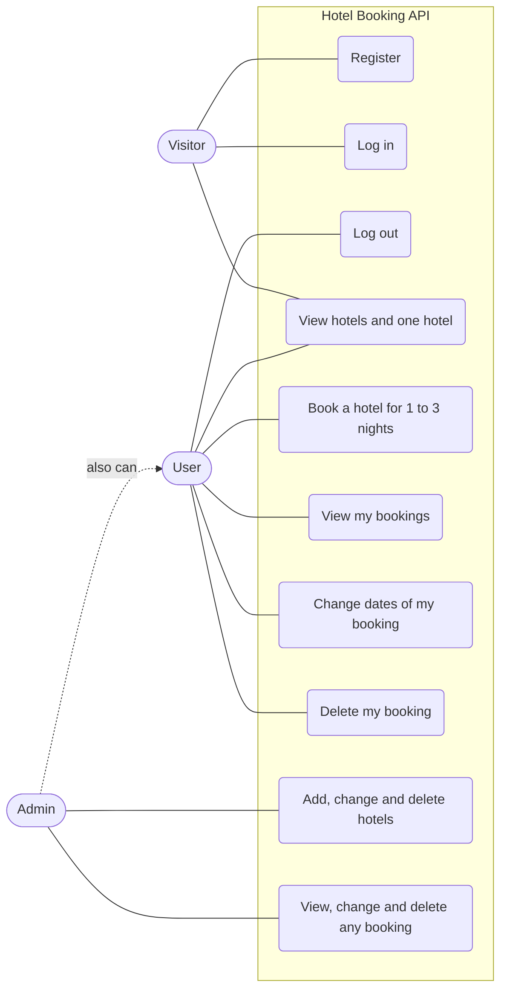
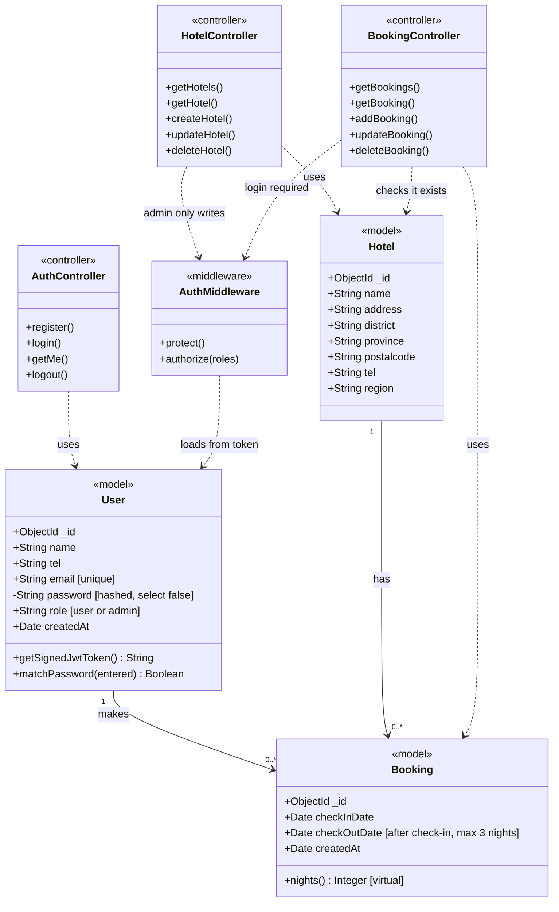
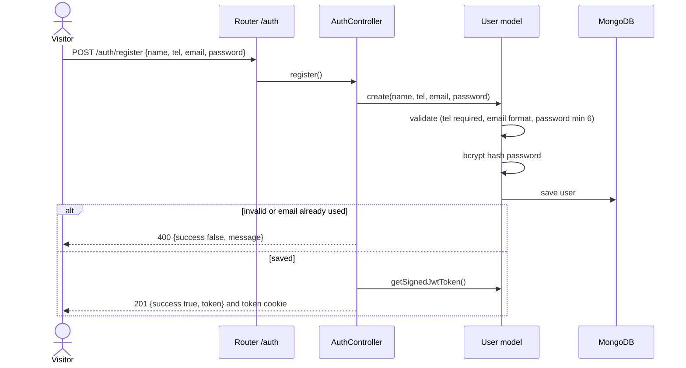
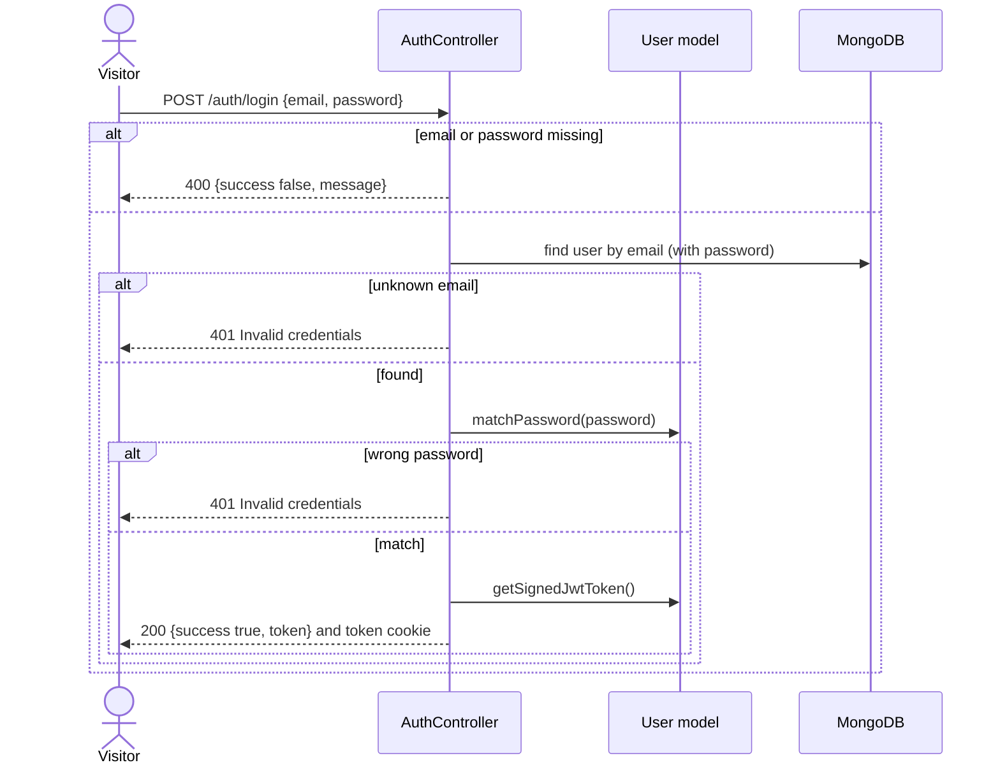
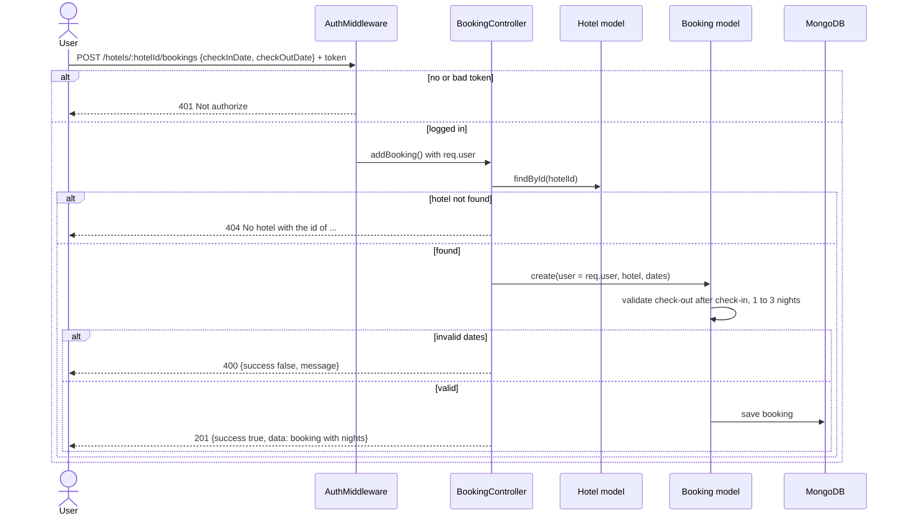
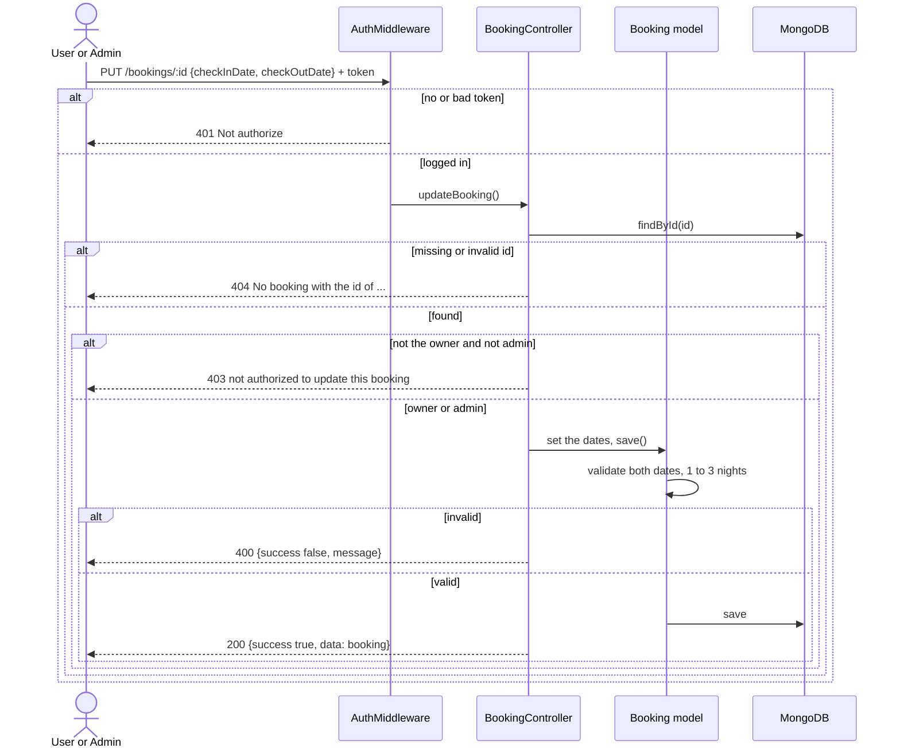
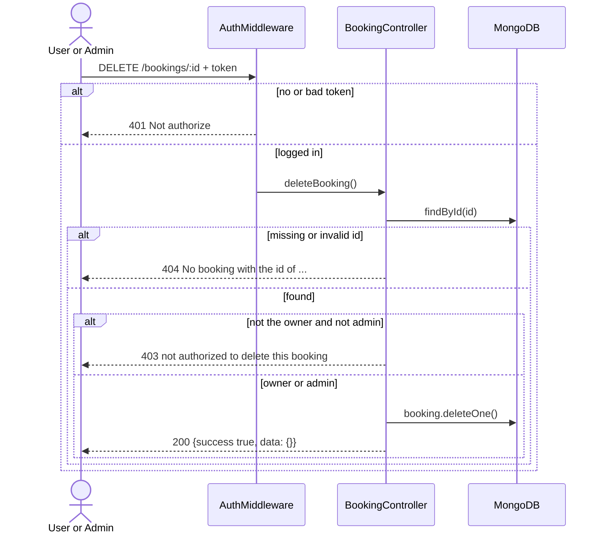

# Diagrams for the changed base system (A8)

Use case, class (UML profile) and sequence diagrams for the base parts that changed since Assignment 7: hotels, bookings with check-in and check-out dates, and auth with `tel`. Reviews are not included. Diagrams are Mermaid, so GitHub renders them; paste them into the slides as images. Endpoints and rules are in `docs/api.md`.

## 1. Use case diagram

Actors: a visitor who is not logged in, a registered user, and an admin (an admin can do everything a user can).

## 2. Class diagram (UML profile)

Stereotypes used as the profile: `<<model>>` a Mongoose schema stored in MongoDB, `<<controller>>` request handlers, `<<middleware>>` Express middleware that runs before a controller. Associations come from `ref` fields; the `bookings` link on Hotel is a virtual populate.

Rules on the classes: deleting a Hotel deletes its Bookings; a Booking is 1 to 3 nights (`checkOutDate` after `checkInDate`); users only touch their own Bookings, admins any.

## 3. Sequence diagrams

### 3.1 Register

### 3.2 Log in

### 3.3 Create a booking

### 3.4 Edit a booking (change dates)

### 3.5 Delete a booking

