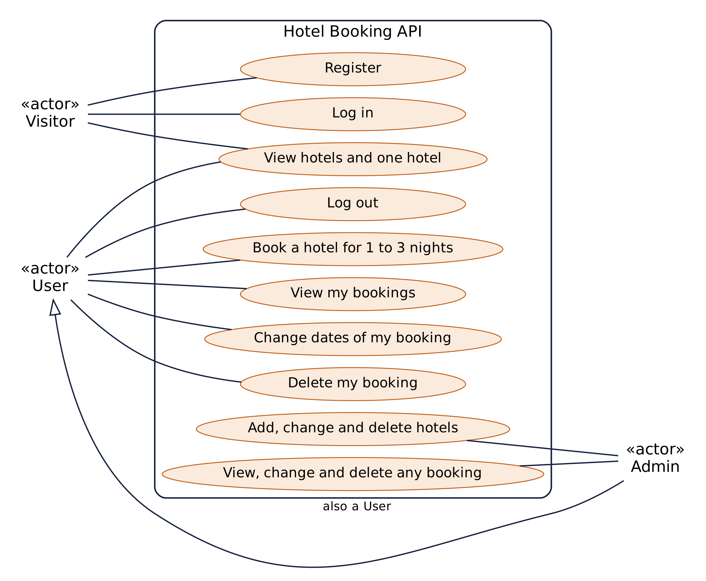
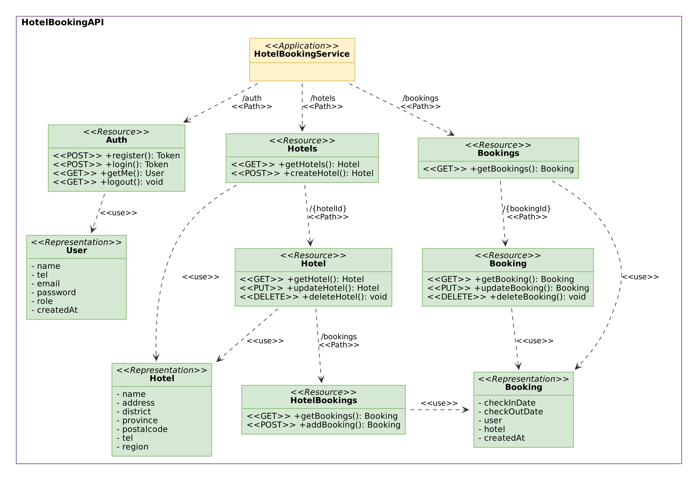
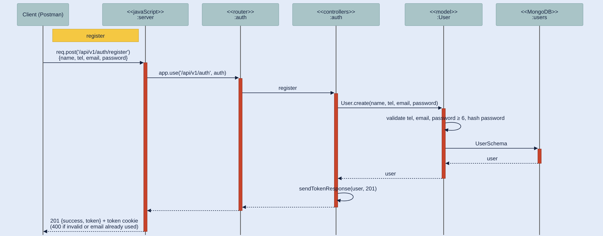
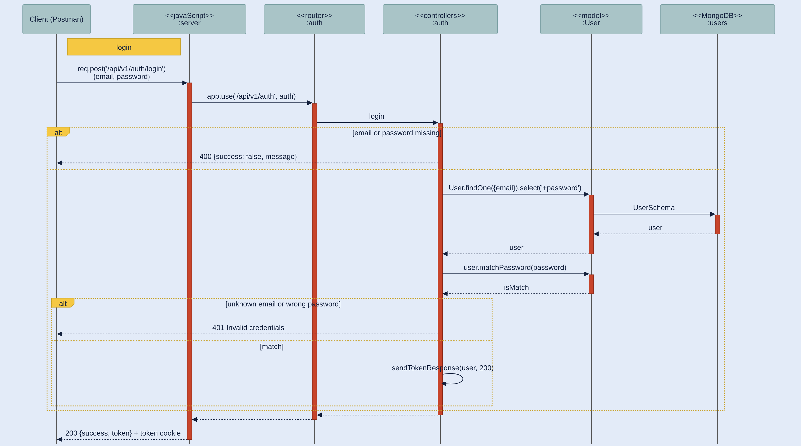
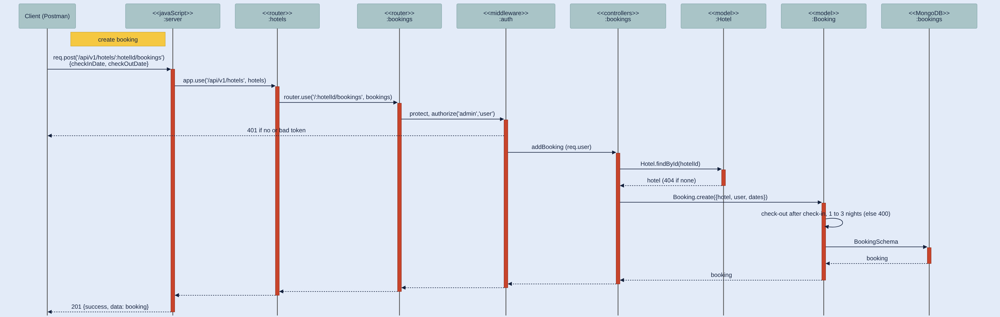
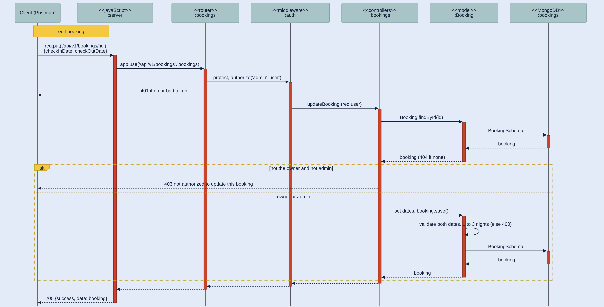
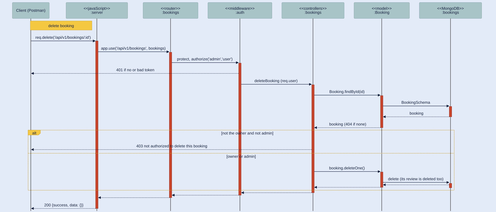

# Diagrams for the changed base system (A8)

Use case, class (UML profile) and sequence diagrams for the base parts that changed since Assignment 7: hotels, bookings with check-in and check-out dates, and auth with `tel`. Reviews are not included (the brief asks for no diagrams of the extra requirements). Endpoints and rules are in `docs/api.md`.

The class and sequence diagrams follow the course's chapter 6 notation: the REST UML profile for the class diagram, and `server`, `router`, `controllers`, `model` and `MongoDB` lifelines with activation bars for the sequence diagrams. These are the full-size versions of the images on the final slides. Sources are next to each image in `docs/diagrams/`: Graphviz (`.dot`) for the use case and class diagrams, Mermaid (`.mmd`) for the sequence diagrams.

To render them again:

```sh
dot -Tpng -Gdpi=200 docs/diagrams/class-diagram.dot -o docs/diagrams/class-diagram.png
dot -Tpng -Gdpi=200 docs/diagrams/use-case.dot -o docs/diagrams/use-case.png
npx -p @mermaid-js/mermaid-cli mmdc -i docs/diagrams/sequence-register.mmd -o docs/diagrams/sequence-register.png -c docs/diagrams/sequence-mermaid-config.json -b "#E3EBF8" -s 2 -w 2000
```

## 1. Use case diagram

Actors: a visitor who is not logged in, a registered user, and an admin (an admin is also a user).



Source: [`diagrams/use-case.dot`](diagrams/use-case.dot)

## 2. Class diagram (UML profile)

Stereotypes of the REST profile:

| Stereotype | Meaning |
| --- | --- |
| `<<Application>>` | The service, `HotelBookingService` (`server.js`) |
| `<<Resource>>` | A REST resource; its operations carry the HTTP method `<<GET>>`, `<<POST>>`, `<<PUT>>` or `<<DELETE>>` |
| `<<Path>>` | The URL segment from one resource to the next: `/auth`, `/hotels`, `/hotels/{hotelId}`, `/hotels/{hotelId}/bookings`, `/bookings`, `/bookings/{bookingId}` (all under `/api/v1`) |
| `<<Representation>>` | The data a resource returns: `User`, `Hotel`, `Booking` |
| `<<use>>` | The resource reads or writes that representation |



Source: [`diagrams/class-diagram.dot`](diagrams/class-diagram.dot)

Rules on the classes: deleting a Hotel deletes its Bookings; a Booking is 1 to 3 nights (`checkOutDate` after `checkInDate`); users touch only their own Bookings, admins any; hotel writes are admin only.

## 3. Sequence diagrams

Each request goes `server` → `router` → (`middleware` `protect`, `authorize` where login is needed) → `controllers` → `model` → `MongoDB`, and the response goes back the same way.

### 3.1 Register



Source: [`diagrams/sequence-register.mmd`](diagrams/sequence-register.mmd)

### 3.2 Log in



Source: [`diagrams/sequence-login.mmd`](diagrams/sequence-login.mmd)

### 3.3 Create a booking



Source: [`diagrams/sequence-create.mmd`](diagrams/sequence-create.mmd)

### 3.4 Edit a booking (change dates)



Source: [`diagrams/sequence-edit.mmd`](diagrams/sequence-edit.mmd)

### 3.5 Delete a booking



Source: [`diagrams/sequence-delete.mmd`](diagrams/sequence-delete.mmd)
